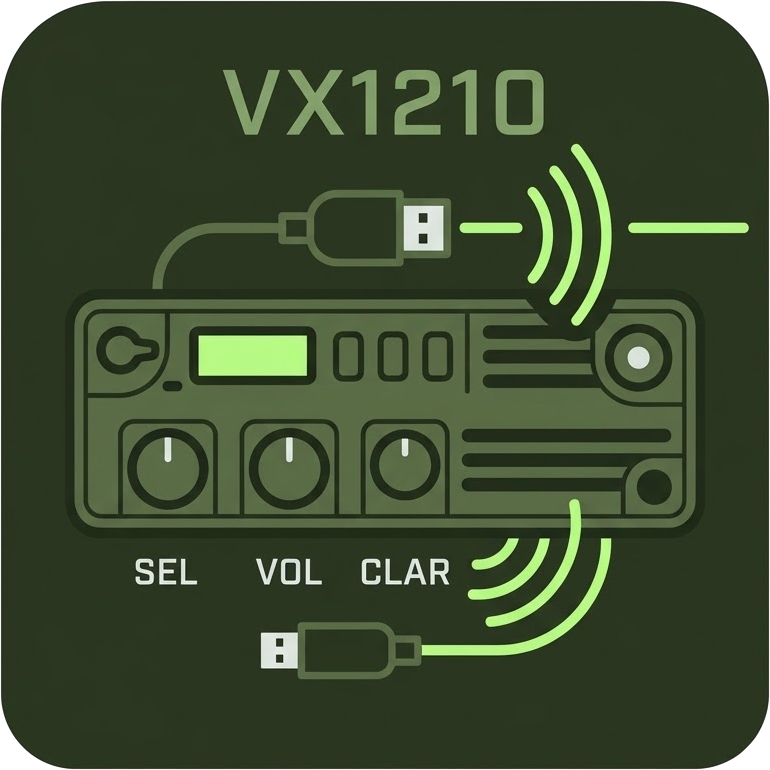

<p align="center">
  
</p>

<h1 align="center">CE42 Next</h1>

<p align="center">
  Open-source programming software for the <b>VX-1210</b> HF manpack transceiver —
  a modern re-implementation of Vertex Standard CE42.
</p>

<p align="center">
  <a href="https://github.com/vimace2003/VX1210-programmer/actions/workflows/ci.yml"></a>
  <a href="https://github.com/vimace2003/VX1210-programmer/releases/latest"></a>
  <a href="LICENSE"></a>
</p>

Reads and writes the radio through the SVC-1200 cable and keeps full compatibility with CE42 `.C42` files.

- Desktop program for **Windows, macOS and Linux**, or **web app** in Chrome/Edge (Web Serial) — nothing to install
- Byte-compatible `.C42` files, CSV import/export of channels
- Same safe write sequence as CE42: alignment and calibration data of the radio are never overwritten
- Modes named as hams use them: LSB, USB, CW, AM, DATA (CE42's J3E/A1A/A3E/J2B still accepted in CSV)
- Simulated radio for training and tests
- Interface in Português, English, Español, Русский (asked at start-up)

> [!WARNING]
> The protocol was recovered from the original program and validated against a simulator, **not yet
> against a real radio**. Test with a radio you can afford to re-program with the original CE42:
> **read first**, compare, then write. Please share your results with a
> [radio test report](https://github.com/vimace2003/VX1210-programmer/issues/new?template=radio_test.yml).

## Download

Get the files from the [latest release](https://github.com/vimace2003/VX1210-programmer/releases/latest),
or use the **web app**: <https://vimace2003.github.io/VX1210-programmer/>

| System | File |
| --- | --- |
| Windows 10/11 (x64) | `CE42-Next-Setup-<version>.exe` (installer) or `CE42-Next-<version>-portable.exe` |
| macOS Apple Silicon | `CE42-Next-<version>-mac-arm64.dmg` |
| macOS Intel | `CE42-Next-<version>-mac-x64.dmg` |
| Linux x64 | `CE42-Next-<version>-linux-x86_64.AppImage` or `ce42-next_<version>_amd64.deb` |
| Linux arm64 (e.g. Raspberry Pi 4/5, 64-bit OS) | `CE42-Next-<version>-linux-arm64.AppImage` or `ce42-next_<version>_arm64.deb` |

`SHA256SUMS.txt` in each release lists the checksums.

The packages are not signed with paid certificates, so the system warns on the first run:

- **Windows** — SmartScreen "Windows protected your PC" → *More info* → *Run anyway*.
- **macOS** — "cannot verify the developer": open *System Settings → Privacy & Security* and click
  *Open Anyway* (or right-click the app → *Open*). If macOS says the app is *damaged*, run
  `xattr -dr com.apple.quarantine "/Applications/CE42 Next.app"`.
- **Linux** — your user needs access to serial ports: `sudo usermod -aG dialout $USER`
  (Arch/Fedora: group `uucp`/`dialout`), then log out and in.
  AppImage: `chmod +x CE42-Next-*.AppImage`. If it exits with a sandbox error (Ubuntu 24.04+),
  install the `.deb` instead or start it with `--no-sandbox`.

The serial port appears as `COM3` on Windows, `/dev/cu.usbserial-…` on macOS and `/dev/ttyUSB0` on Linux.
USB-serial adapters may need a driver (FTDI, Prolific, CH340) on Windows and macOS.

## Building from source

Requires [Node.js](https://nodejs.org) 22 or newer.

```sh
npm install
npm run dev            # web app on http://localhost:5173
npm test               # core + UI tests
npm run build          # static web app in apps/web/dist (serve over https or localhost)
npm run desktop        # run the desktop app
npm run dist:desktop   # installers for the current system in apps/desktop/release/
```

On Windows, `start.cmd` installs the dependencies and opens the web app.
Web Serial only works on `https://` or `http://localhost`; opening `dist/index.html` from disk does not
give access to the serial port.

`npm run smoke -w @ce42/desktop` starts the packaged program with a hidden window and checks it end to
end against the simulated radio (on headless Linux, prefix it with `xvfb-run -a`).

### Icon and logo

`branding/logo-source.png` is the artwork. `npm run icon -w @ce42/desktop` removes its white
background and regenerates `branding/logo.png`, the program icons (`apps/desktop/build/icon.ico`,
`icon.png`), the in-app logo and the web favicon.

## Layout

```
packages/core   memory map, .C42 codec, sanitiser, CSV, clone protocol, radio simulator (no dependencies)
apps/web        React UI + Web Serial transport
apps/desktop    Electron shell: native port chooser, packaging for Windows/macOS/Linux
docs/           PROTOCOL.md, MEMORY_MAP.md, REVERSE_ENGINEERING.md
```

`@ce42/core` is transport agnostic (`ByteTransport`), so other shells or a CLI can reuse it unchanged.

## Scope

Implemented: channels (500), all *Common*, *Selcall* and *Telephone* settings, programmable keys,
antenna tuner memory, read/write radio, files, CSV.

Not implemented on purpose (service functions that can damage calibration): alignment, temperature
correction, serial writer, firmware update. Their data is preserved and documented.

## Contributing

See [CONTRIBUTING.md](CONTRIBUTING.md). Reports from real radios, translations and bug reports are
especially welcome. This project follows the [Contributor Covenant](CODE_OF_CONDUCT.md).
Security issues: see [SECURITY.md](SECURITY.md).

## License and disclaimer

Copyright © 2026 PP5KJ. Licensed under the [GNU General Public License v3.0 or later](LICENSE).

CE42 Next is an independent project, written for interoperability (see
[docs/REVERSE_ENGINEERING.md](docs/REVERSE_ENGINEERING.md)); it contains no code of the original
software. It is not affiliated with or endorsed by Vertex Standard, Motorola Solutions or Yaesu.
*Vertex Standard*, *VX-1210* and *CE42* are trademarks of their respective owners. The sample files in
`packages/core/test/fixtures` ship with the original CE42 installer and are used only as test data.

The program is provided **without any warranty**. Programming a transceiver with wrong data can
put it off-frequency or out of legal limits; you are responsible for operating within your licence.
